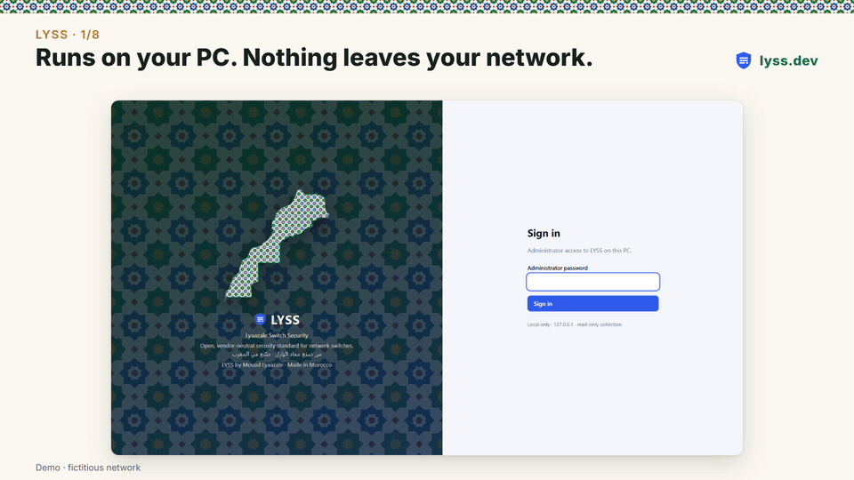

# LYSS: Lyaazale Switch Security

[](https://github.com/lyss-project/lyss/actions/workflows/tests.yml)
[](LICENSE)
[](LICENSE-SPEC)
[](https://www.python.org/downloads/)
[](https://lyss.dev)

**Telnet still on. SNMP "public". Firmware with an exploited flaw. Would you find them on your
switches?**

LYSS is an open, vendor-neutral security standard for network switches, and a free, read-only
tool that checks your switches against it, shows the evidence and gives the fix.

**Try it now, nothing to install:** paste a switch configuration at
**[lyss.dev/audit.html](https://lyss.dev/audit.html)**. LYSS runs in your browser; nothing is uploaded.



<sub>Demo on a fictitious network. Cisco IOS · Cisco Business · HPE Aruba AOS-S · MikroTik RouterOS · SONiC · Website: [lyss.dev](https://lyss.dev) · Try it in your browser: [lyss.dev/audit.html](https://lyss.dev/audit.html)</sub>

LYSS defines **what** a securely managed switch looks like, once, independently of any vendor
(the [specification](docs/LYSS-Specification.md)), and **how to verify it** on each platform
(adapters). Switches are assessed against conformance levels:

- **Level 1, Baseline**: no cleartext management, no default or recoverable credentials,
  supported firmware without known critical or exploited vulnerabilities, automatic backups.
- **Level 2, Hardened**: central authentication, restricted and modern management access,
  remote logging and time synchronization, access-port hygiene.
- **Level 3, Advanced**: access-layer protection against attacks from user ports: DHCP snooping,
  ARP inspection, 802.1X / MAC authentication, storm control, no CDP/LLDP towards users
  (opt-in: `lyss audit --level 3`, or Settings > Assessment).

> Status: **0.16, draft specification 0.7, preview.** The specification and the tool may still change
> before 1.0 (control IDs stay stable). Feedback and adapters for other platforms are welcome.
> Author: Mouad Lyaazale (معاد اليازل).

## Try it in two minutes (no switch needed)

```sh
python -m venv lyss-env
lyss-env/bin/pip install lyss           # Windows: lyss-env\Scripts\pip install lyss
lyss-env/bin/lyss demo --open           # Windows: lyss-env\Scripts\python -m lyss demo --open
```

Or from the source code (to contribute, or to read the adapters and the specification next to it):

```sh
git clone https://github.com/lyss-project/lyss.git && cd lyss
python -m venv .venv
.venv/bin/pip install -e .              # Windows: .venv\Scripts\pip install -e .
.venv/bin/python -m lyss demo --open    # Windows: .venv\Scripts\python -m lyss demo --open
```

**No connection to your devices at all?** Audit a configuration you saved yourself (a MikroTik
`/export`, a Cisco or HPE `show running-config`, a SONiC config_db): nothing is sent anywhere.
The platform is recognised from the file.

```sh
lyss audit --level 2 router.rsc      # or a folder of saved configurations
```

Or, without installing anything, paste it into **[lyss.dev/audit.html](https://lyss.dev/audit.html)**:
LYSS runs inside the page and the configuration is not uploaded.

See [docs/OFFLINE.md](docs/OFFLINE.md): how to save the configuration on each platform, what a
configuration alone can and cannot tell, and how to add device state by hand.

An installed LYSS keeps its data (devices, encrypted credentials, results) in `%LOCALAPPDATA%\LYSS`
on Windows and `~/.local/share/lyss` elsewhere; a source checkout in `private/`. `LYSS_DATA_DIR`
overrides both.

This starts a simulated network of nine fictitious switches (Cisco IOS, Cisco Small Business,
HPE Aruba, MikroTik RouterOS, SONiC, Arista EOS, one of them hardened up to Level 3) on 127.0.0.1 and the LYSS web interface on a separate demo data folder. Everything
you see is invented. See [docs/DEMO.md](docs/DEMO.md). On Windows, double-click
`Start-LYSS-Demo.cmd` instead (the first start installs LYSS).

**Testing LYSS on your switches?** Start with [docs/TESTERS.md](docs/TESTERS.md), give LYSS a
read-only account ([docs/ACCOUNTS.md](docs/ACCOUNTS.md)), and tell me what you found in the
[issues](https://github.com/lyss-project/lyss/issues). Website: https://lyss.dev

## Platform support

| Platform | Level 1 | Level 2 | Level 3 | Device state | Remediation | Firmware data |
|---|---|---|---|---|---|---|
| Cisco IOS / IOS-XE (Catalyst) | yes | yes | yes | yes | yes | Catalyst 1000 |
| Cisco Small Business / Business (SG200-550X, CBS) | yes | yes | yes | yes | yes | SG200/300/500, 350, CBS250/350 |
| HP ProCurve / HPE Aruba AOS-S | yes | yes | yes | yes | basic | AOS-S 16.x |
| MikroTik RouterOS 6.x / 7.x (CRS, RouterBOARD, CHR), preview | yes | yes | yes (RouterOS 7) | yes | no | RouterOS (CISA KEV + critical) |
| SONiC (community builds), preview | yes | yes | not applicable | yes | no | no |
| Arista EOS (7000 series, cEOS / vEOS), preview | yes | yes | yes | yes | no | EOS (critical advisories) |
| Zyxel GS1900, preview: **firmware only**, offline | no | no | no | no | no | GS1900 (CVE-2026-7273, CISA KEV) |

Level 3 (Advanced: DHCP snooping, ARP inspection, 802.1X / MAC authentication, storm control,
no CDP/LLDP towards users) is opt-in: `lyss audit --level 3`, or Settings > Assessment in the web
interface. It is not applicable on SONiC (data-centre fabric, no user ports) nor on any switch
without access ports.

Where each platform has been validated, and what is not validated yet, is in
[docs/VALIDATION.md](docs/VALIDATION.md).

Cisco IOS and Cisco Small Business are validated on real switches; HPE Aruba AOS-S on the
simulator and synthetic outputs so far (reports from real AOS-S switches are welcome). MikroTik
RouterOS is validated on CHR 7.25.1: LYSS reads `/export terse` (never `show-sensitive`, so no
secret is collected) and `print terse` state, because RouterOS exports only non-default settings.
Give the LYSS account a read-only group without the "sensitive" policy. SONiC is
validated on the SONiC-VS 202505 virtual switch: LYSS reads its config_db JSON and `show`
commands. Two SONiC controls stay "unknown" by design: the sudo account's password hash
(in /etc/shadow, not readable by a read-only account) and firmware support (no published
end-of-support data for community builds). Arista EOS is validated on cEOS-lab 4.37.0F
(default, insecure and hardened configurations, LLDP topology between two switches). Its firmware
check covers the critical EOS advisories with fixed releases (SA-0071, SA-0072); the one EOS flaw
in the CISA KEV catalogue (CVE-2026-7473, Security Advisory 0137) has no fixed release, only a
mitigation ACL, which the report explains.

**Zyxel GS1900** (web-managed; Zyxel's CLI is a troubleshooting shell): LYSS checks the firmware
against CVE-2026-7273, the web-interface flaw exploited on about 1,000 GS1900 switches since
August 2026 (CISA KEV). Paste the output of `show version`, or the text of the web page
*System Information*, into [lyss.dev/audit.html](https://lyss.dev/audit.html) or run
`lyss audit version.txt`. The other controls stay "unknown" until the configuration format is
verified on a real switch: if you own a GS1900, a sanitized configuration export helps.

## What the tool does

- **Read-only collection** over SSH, in parallel, optionally through an SSH jump host.
- **Works with old switches** that only speak SHA-1 SSH (Cisco SG300, older Catalyst images),
  without weakening connections to modern ones: SHA-1 is allowed only for a switch that offers
  nothing else, and the report says so (see [SECURITY.md](SECURITY.md)).
- **Assessment** with evidence for every verdict (secrets redacted) and recommended fixes.
- **Discovery** of unmanaged switches from LLDP/CDP neighbours and SSH range scans.
- **Topology map** built from neighbour tables.
- **History**: configuration versions with diffs, scan trends, regression alerts.
- **Scheduled scans**, **e-mail alerts**, **CISO Assistant** evidence push (disabled by default).
- **SIEM events** over syslog or a JSON-lines file, with ready Wazuh decoder and rules
  ([integrations/wazuh](integrations/wazuh/README.md)).
- **Oxidized**: assess the configurations Oxidized already backs up, without SSH
  ([integrations/oxidized](integrations/oxidized/README.md)).
- **CISO Assistant library**: the LYSS framework and its ISO 27001:2022 mapping are
  [part of CISO Assistant](https://github.com/intuitem/ciso-assistant-community/pull/5246) (merged
  2026-11-09, in its built-in library store from the release after v4.2.2), and ready to import into
  older versions ([integrations/ciso-assistant](integrations/ciso-assistant/README.md)).
- **Reports**: standalone HTML (printable to PDF) and JSON, with ISO 27001 / NIST / CIS mappings.
- **Framework crosswalk** ([docs/MAPPINGS.md](docs/MAPPINGS.md)): which LYSS controls support
  each point of NIS2 Article 21(2), each ISO/IEC 27001:2022 Annex A control, NIST SP 800-53 and
  CIS Controls v8 (informative).
- **Optional remediation** (off by default): low-risk fixes only, previewed, applied one switch at
  a time, verified over a new connection, rolled back automatically, saved only after
  verification, and logged.
- **Switch simulator** (`python -m lyss sim`) to test collection, topology and remediation
  without hardware.

## Getting started

Windows: double-click `Start-LYSS.cmd`; http://127.0.0.1:8765 opens. The first start installs LYSS
into `.venv` (needs Python 3.10+) and asks for an administrator password.

From source (any OS):

```sh
python -m venv .venv
.venv/bin/pip install -e .           # Windows: .venv\Scripts\pip install -e .
.venv/bin/python -m lyss ui          # local web interface on 127.0.0.1:8765
```

Docker (Linux): `docker compose up -d`, then http://127.0.0.1:8765. Data lives in the `lyss-data`
volume; back up `/data/master.key`, which encrypts the stored credentials and configurations
(better: pass the key in `LYSS_MASTER_KEY` and keep it outside the volume).

Command line:

```sh
python -m lyss collect                 # collect and assess every switch (read-only)
python -m lyss collect --scheduled     # same, from cron / Task Scheduler (automatic backup)
python -m lyss audit --vendor cisco_sb --level 2 path/to/configs/
```

Is management really unreachable from user networks? Run `lyss probe` on a user PC and import the
result: see [docs/REACHABILITY.md](docs/REACHABILITY.md).

Configurations in Git (Oxidized, or kept by hand)? The **GitHub Action** checks them at every push
or pull request and fails the job on a weakening change: see [docs/CI.md](docs/CI.md).

Before production use, read the [threat model](docs/THREAT-MODEL.md), the
[scale figures](docs/SCALE.md) (1,008 simulated switches collected and assessed by one instance)
and the [versioning policy](docs/VERSIONING.md) (draft specification until 1.0: pin a version).
LYSS watches itself: `/health` reports when scheduled scans have stopped, and an optional
heartbeat URL alerts an external monitor.

## Repository layout

| Path | Content | Licence |
|---|---|---|
| `spec/lyss-spec.yaml` | The specification (normative source) | CC BY 4.0 |
| `docs/LYSS-Specification.md` | Specification document, generated by `tools/build_spec.py` | CC BY 4.0 |
| `data/firmware.yaml` | Firmware knowledge base, every fact sourced | CC BY 4.0 |
| `adapters/` | Per-platform checks and remediations | AGPL-3.0-only + terms |
| `src/lyss/` | Engine, collector, discovery, topology, history, web interface | AGPL-3.0-only + terms |
| `tests/` | Synthetic test cases and test suite | AGPL-3.0-only + terms |

## Licence and attribution

LYSS is free software: you can use, study, modify and share it. The software is licensed under
the GNU Affero General Public License v3 (AGPL-3.0-only) with additional terms under its section 7,
and the specification under CC BY 4.0. In short:

- Every copy and every modified version, including one offered to users over a network, must keep
  the attribution **LYSS by Mouad Lyaazale · Made in Morocco** where the original shows it: the
  footer of the web interface, the login page and the reports. Keep the `NOTICE` file.
- A modified version must be marked as modified and must publish its source code to its users
  (AGPL).
- The names "LYSS" and "Lyaazale Switch Security" and the LYSS logo are not licensed for modified
  versions: see [TRADEMARKS.md](TRADEMARKS.md).

The exact terms are in [LICENSE](LICENSE), [LICENSE-SPEC](LICENSE-SPEC) and [NOTICE](NOTICE).

## Support LYSS

LYSS is free and built on personal time. If it helps you secure your network, you can support its
development on [Ko-fi](https://ko-fi.com/lyaazale). Reporting wrong verdicts and sharing the
project help just as much.

## Data handling

Real switch configurations contain password hashes, keys and topology. They stay in `private/`
(or `LYSS_DATA_DIR`), which is never committed. See [SECURITY.md](SECURITY.md) for the security
design and [CONTRIBUTING.md](CONTRIBUTING.md) to contribute controls or adapters.
